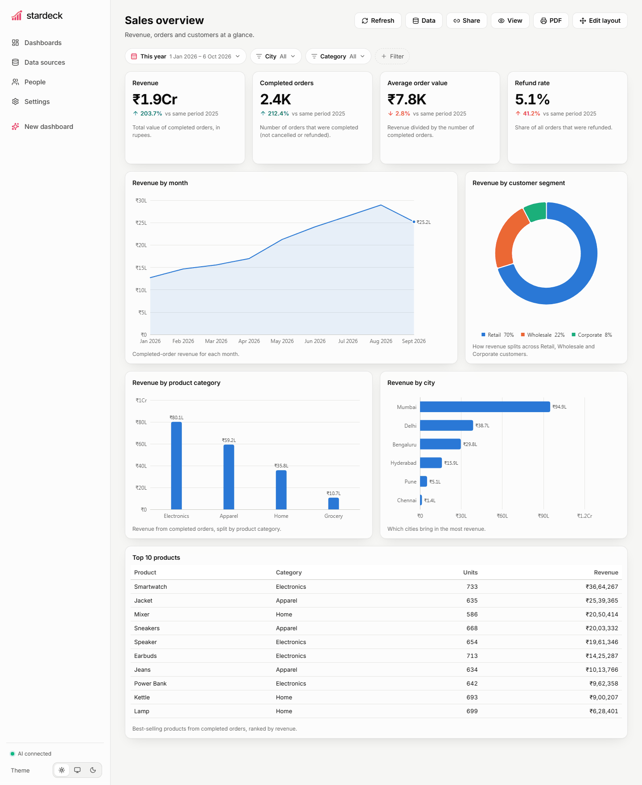
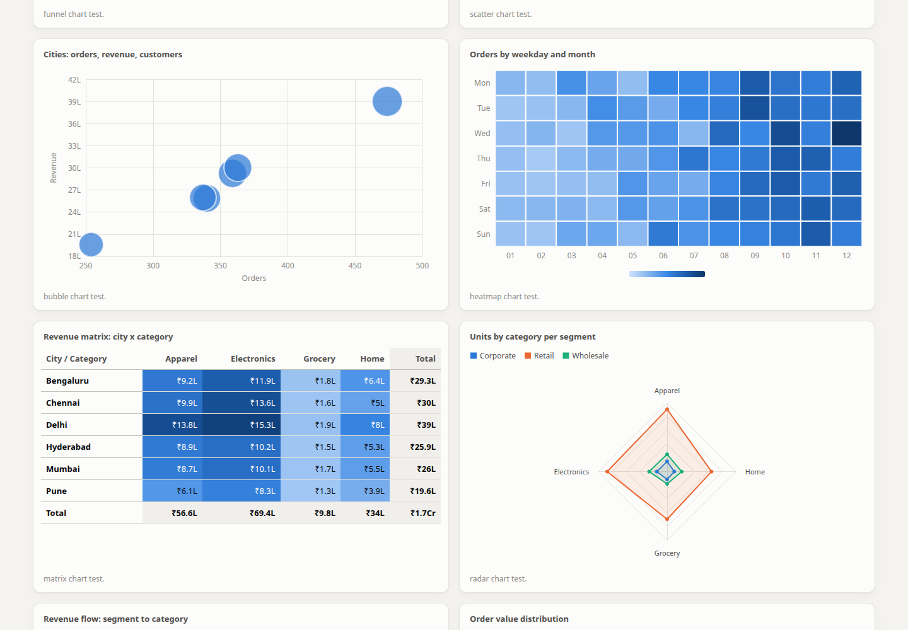
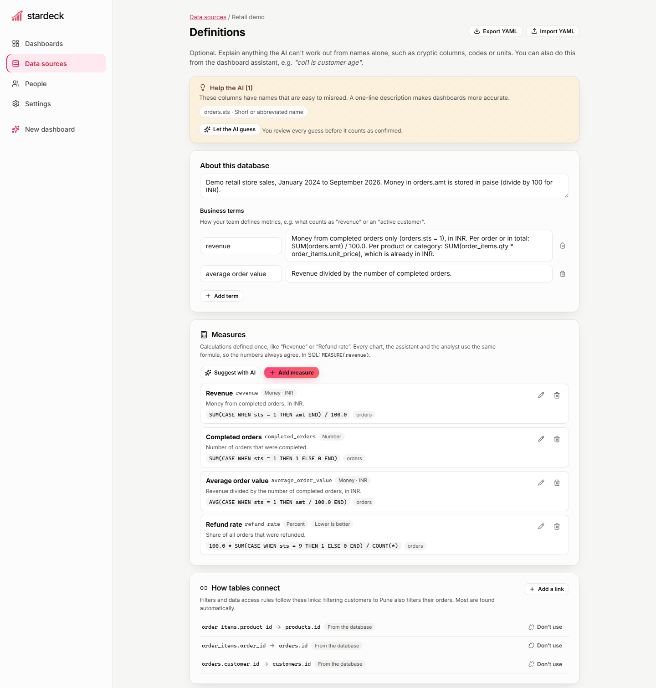
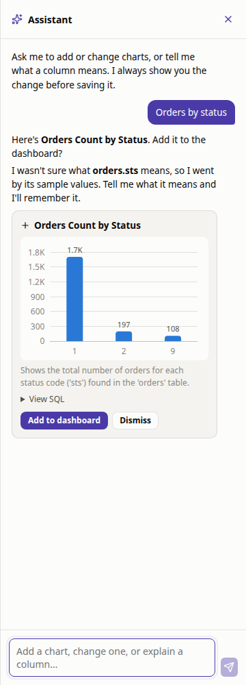
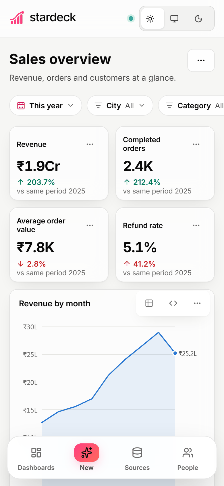

<h1>
  <picture>
    <source media="(prefers-color-scheme: dark)" srcset="docs/images/logo-dark.png">
    
  </picture>
</h1>

**AI-built dashboards for your database, running entirely on your own hardware.**

Connect a database or upload a spreadsheet, and Stardeck's local AI builds a dashboard for it.
Then refine it by chatting: *"add revenue by month"*, *"only show the top 5"*, *"sts 9 means refunded"*.
Your data and your AI never leave your network.



## Features

- **One-click dashboards.** An AI planner picks 6–9 useful widgets (KPIs, trends, breakdowns,
  top-N tables), builds each one, and lays them out. About 30–40 s with a 9B model.
- **A dashboard assistant with two agents.** The *dashboard builder* adds, changes, renames, removes or explains
  widgets in plain English. The *data analyst* answers questions ("which city grew fastest?") with real
  queries, shows its numbers and working, and can turn an answer into a chart.
  Every change is shown as a preview you confirm; nothing is applied behind your back.
- **Explain your data once.** Cryptic columns like `col1`, codes like `sts = 9` and units like
  paise are flagged automatically. Describe them on the Definitions page or in chat (or let the AI
  guess and review its guesses), and every chart gets them right. In our evals this lifts accuracy
  from 9/19 to 19/19.
- **Built for non-technical users, honest with technical ones.** Every widget has a
  plain-English summary, and the exact SQL is one click away, editable, with a live preview.
- **Read-only by design.** Only single `SELECT` statements are allowed, and every connection is
  also opened read-only at the database level, with a query timeout.
- **Date filters that can't be hallucinated.** The dashboard's date range is applied by editing
  the SQL syntax tree, never by the model. KPIs compare against the previous period.
- **Transform data like Power Query.** Build *prepared tables* step by step: filter, rename, change
  types, replace codes with labels, fill blanks, calculated and conditional columns, split columns,
  date parts, merge and append tables, group and summarize, pivot and unpivot. A live preview shows each step, column headers have quick
  actions, and you can describe a change in plain English for the AI to turn into a step. Nothing is
  written to your database: recipes compile to SQL and run live, on every connector.
- **20+ chart types, like Power BI and Tableau.** Column/bar (clustered, stacked, 100% stacked),
  line, area (stacked), waterfall, pie, donut, treemap, funnel, scatter, bubble, heatmap, matrix
  (pivot with totals), radar, Sankey, histogram, box plot, gauge, number cards, tables, and maps on
  OpenStreetMap. The chart menu only offers types that fit the widget's data, and the AI picks
  sensible ones on its own (and fixes ones that don't fit).
- **Share and export.** Read-only view links, PDF export, CSV download per widget.
- **Postgres, MySQL, SQLite, CSV and Excel.** Optional password protection. Light and dark themes.
  Works on phones.



| Definitions | Assistant | Phone |
|---|---|---|
|  |  |  |

## Quick start

You need [Docker](https://docs.docker.com/get-docker/) and a machine that can run a local model
(the defaults suit a GPU with 8 GB+ VRAM, or Apple Silicon).

```bash
git clone <this repo> stardeck && cd stardeck
cp .env.example .env            # pick a model; optionally set STARDECK_PASSWORD
docker compose up -d
docker compose logs -f ollama-pull   # the first start downloads the model
```

Open <http://localhost:3000>. A **Retail demo** data source and dashboard are included so you can
try everything before connecting your own data.

### Already running LM Studio, vLLM or llama.cpp?

Stardeck talks to any OpenAI-compatible endpoint. Point it at yours in `.env`:

```bash
STARDECK_LLM_BASE_URL=http://host.docker.internal:1234/v1   # LM Studio
STARDECK_LLM_MODEL=qwen/qwen3.5-9b
```

See [docs/configuration.md](docs/configuration.md) for every setting.

## Choosing a model

Measured on the bundled eval suite (19 dashboard questions over the demo database):

| Model | With definitions | Without | Avg. time per widget |
|---|---|---|---|
| Qwen 3.5 9B | 19/19 | 9/19 | ~4 s |
| Qwen 3.6 35B-A3B | 19/19 | 9/19 | ~7 s |

Measured on an RTX 5070 (12 GB) with LM Studio; every chart type was also judged sensible (13/13).
Small models vary a little between runs: on the current demo data the 9B scores 18–19/19, the
occasional miss being a unit slip (dividing an amount that is already in rupees by 100).
The 9B model is the recommended default: as accurate here, faster, and fits in less memory. Writing definitions for
cryptic columns matters far more than model size. Run the evals on your own hardware with
`uv run python evals/run_eval.py --model <name>` (see [docs/architecture.md](docs/architecture.md#evals)).

## Development

```bash
./scripts/dev.sh        # backend on :8000, frontend on :5173 (reachable from your LAN)
```

or separately:

```bash
cd backend && uv sync && uv run uvicorn stardeck.main:app --reload
cd frontend && npm install && npm run dev
```

Tests: `cd backend && uv run pytest` · Lint: `uv run ruff check .` and `cd frontend && npm run lint`.

More: [architecture](docs/architecture.md) · [configuration](docs/configuration.md) ·
[adding a connector](docs/connectors.md) · [contributing](CONTRIBUTING.md) · [changelog](CHANGELOG.md)

## Security notes

- Connect with a **read-only database account**. Stardeck enforces read-only itself, but a
  read-only account is the strongest guarantee.
- If Stardeck is reachable by others (LAN, VPN), set `STARDECK_PASSWORD`.
- Saved database passwords are encrypted with a key in `data/secret.key` (or `STARDECK_SECRET_KEY`).
  Back it up together with the data volume.
- Columns marked **Hide from AI** are never sent to the model.
- **Maps** load tiles from OpenStreetMap and look up place names (e.g. "Pune") with OpenStreetMap's
  Nominatim service; only map views and place names leave your network, and lookups are cached.
  Set `STARDECK_GEOCODER=off` or point the map settings at self-hosted servers to keep it all local.

## License

[Apache-2.0](LICENSE)
